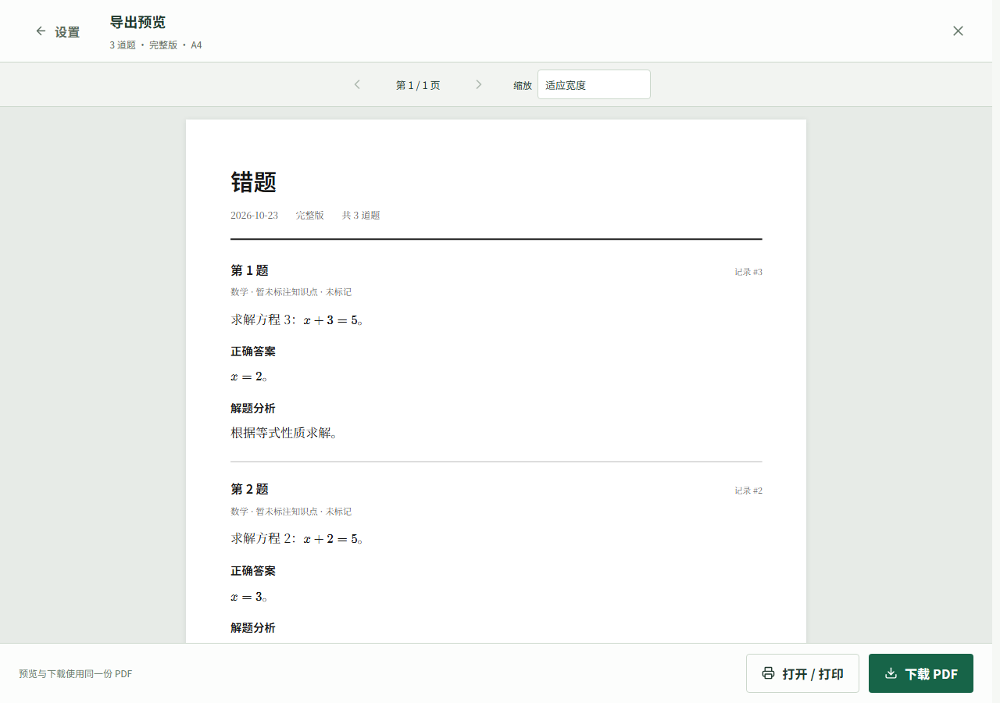
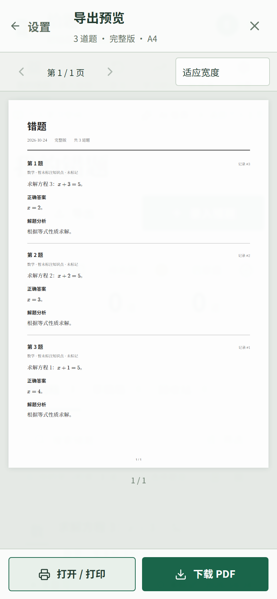
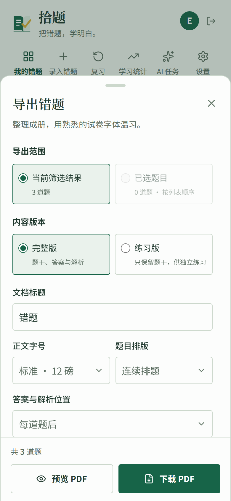

# 错题 PDF 导出 · 2026-10-23

## 使用

在“我的错题”点击“导出”，可导出当前筛选的全部结果或本页所选题目；详情页可导出单题。“下载 PDF”可直接保存文件，“预览 PDF”显示同一份文件的实际分页，再次下载不会重新生成。

默认文档标题为“错题”，A4 纵向、15mm 页边距、12pt 思源宋体正文、思源黑体标题、连续排题。字号可选 10.5／12／14pt，每题可另起一页，单题分页时不添加题目分割线。完整版默认逐题附答案、解析与笔记，也可集中到文末并保留对应题号；选择练习版会取消“包含我的笔记”，隐藏答案、解析和笔记。练习版去除答题留白底线和题目分隔线，连续排题时答题空白可在10–70mm之间按5mm一档调节，默认60mm；手机上下滑动滚轮选择，PC点击上下箭头或输入数值，输入会吸附到最近档位。每题另起一页时隐藏留白设置，也不添加固定答题空白。

正文配图保持原比例、只缩小不放大，详情页居中，PDF与所在正文的左边缘对齐。常规插图按正文行高排版：宽高比不小于1.6的横图最高3行，不小于1的近方图最高4行，其余普通竖图最高5行，同时适应所在内容宽度；字号变化时插图随正文同比例调整。详情、复习和编辑预览采用同一尺寸规则，未附带链接的插图可点击放大、滚轮或双指缩放查看。宽高比小于0.4的超长题图保留单独的整图处理，PDF最高230mm。首图会为必须同页的题号、元信息或小标题预留高度；有图题目和答案条目可按内容块续页，同段多图也可分别换页，每张图片始终完整。超长图整图缩至单页，因此图中文字可能较小；照片上传记录中未插入正文的图片不会自动加入导出。图片链接保留，排版处理不修改保存的正文或上传文件。

手机预览默认适应宽度，支持页码跳转和缩放；预览按可见页加载和释放画布，直接读取已生成 PDF 的二进制数据，每次重试重新读取。文字层样式仅作用于预览，关闭后不会覆盖主页侧栏和主题。打开／打印入口使用同一份 PDF，可使用浏览器或系统 PDF 阅读器打印。宋体、黑体和 KaTeX 字体均从本站加载，不依赖 Google Fonts；字体许可证随静态文件发布。

## 安装与部署

需要 Node.js 24、锁文件中版本的 Playwright 及其配套 Chromium。应用默认从项目的 `data/.playwright` 读取浏览器，该目录不纳入 Git；安装和运行必须使用相同路径及可读取该目录的服务账号。

Windows（项目根目录）：

```powershell
npm ci --cache ./data/.npm-cache
$env:PLAYWRIGHT_BROWSERS_PATH = Join-Path (Get-Location) 'data/.playwright'
npx playwright install chromium
npm run build
npm start
```

Linux（项目根目录；系统依赖安装需要相应权限）：

```bash
npm ci --cache ./data/.npm-cache
export PLAYWRIGHT_BROWSERS_PATH="$PWD/data/.playwright"
npx playwright install --with-deps chromium
npm run build
npm start
```

可在 `.env` 设置 `PLAYWRIGHT_BROWSERS_PATH`，或通过 `MISTAKES_PDF_EXECUTABLE_PATH` 指定已有 Chrome／Chromium 的绝对路径；常规部署建议安装 Playwright 的匹配浏览器。升级 Playwright 后重新执行浏览器安装。现有 Nginx `proxy_read_timeout 120s` 保持不变；Node 须能读取 `public/mistakes/` 的构建结果。没有数据库迁移，发布时保留数据库、上传图片及配置文件。

缺少浏览器或构建资源时只影响 PDF 生成，接口返回可操作的错误提示。文档内只支持有权读取的本站配图；缺失、越权或外链配图会指出所在题号，修复后重试。PDF 只在内存中生成和下载，不另存到服务器磁盘。

## 接口与运行行为

鉴权接口 `POST /api/mistakes/exports/pdf` 接收 `{ source, options }`。`source` 为 `{ ids: number[] }` 或 `{ filters: { lifecycle, subjectId, knowledgePointId, status, rating, keyword, dataType } }`，筛选值为字符串，沿用列表筛选及排序；明确 ID 按提交顺序导出，已删除或不可访问的所选题目会提示重新选择。

`options` 包含 `title`、`version`（`complete`／`practice`）、`includeNotes`、`fontSize`（10.5／12／14）、`layout`（`continuous`／`per-question`）、`practiceSpace`（10–70，每5mm一档，默认60）、`answerPlacement`（`inline`／`appendix`）。未提供的设置使用上述默认值。

成功响应为 `application/pdf`，通过 `Content-Disposition` 提供 UTF-8 文件名，`X-Export-Question-Count` 提供实际题数；失败返回现有 `{ success: false, message }` JSON。前端独立读取二进制响应，不派发题目更新事件。文档日期按上海时区生成。

服务端按需复用 Chromium，每份文档使用独立上下文；同时生成一份、最多等待两份，排队上限30秒、执行上限60秒。取消、断连、超时均释放任务上下文和执行槽，空闲60秒关闭浏览器。渲染器仅读取本地构建资源及已校验归属的配图，不转发会话 Cookie，也不访问任意外部地址。

## 实现与验收

| 步骤 | 状态 | 内容 |
| --- | --- | --- |
| PDF 接口与生成服务 | completed | 鉴权、完整筛选、所选保序和配图权限烟测通过；取消会释放执行槽，包括首次浏览器启动期间 |
| 本地字体与试卷排版 | completed | 独立入口、本地字体、完整／练习版、文末答案、长题续页；超宽行内及块公式按自身宽度适配，正文保持所选字号 |
| 导出设置与分页预览 | completed | PDF.js 分页、文字层、缩放与手机操作通过；预览和下载文件 SHA-256 一致且不重复生成 |
| 验证与文档 | completed | 构建、语法、核心和导出烟测通过；桌面／手机实际浏览器验收通过，部署说明与截图已保存 |

验证命令：`npm run build`、`node scripts/mistakes-smoke.cjs`、`npm run test:export`。导出烟测使用临时数据库和上传目录，实际生成 PDF，核对超过24题的完整筛选、所选保序、单题长练习、文末答案、中文文字层及配图权限。完成后清理测试数据。

2026-10-23 修复验收：

| 步骤 | 状态 | 内容 |
| --- | --- | --- |
| PC 预览与重试 | completed | PDF.js 及 worker 使用兼容构建，直接读取 PDF 字节；模拟缺少新浏览器 API 和首次读取失败，点击重试后正常显示且不重新生成 PDF |
| 两端退出后的主页 | completed | 移除完整阅读器的全局样式；1280×900、390×844 首次及再次预览退出后，主页布局、滚动位置和样式均恢复 |
| 默认文档标题 | completed | 设置、文档标题和文件名回退均为“错题”，导出烟测通过 |
| 练习版与每题分页 | completed | 练习版自动取消笔记；每题另起一页隐藏留白选项，不生成固定留白和题目分割线，浏览器与打印 DOM 检查通过 |

预览回归命令：`npm run test:export-preview`。使用真实 Chromium、隔离数据库和虚构题目，完成后清理临时数据；上述构建、核心与导出烟测也已通过。

2026-10-24 PC 预览加载修复验收：

| 步骤 | 状态 | 内容 |
| --- | --- | --- |
| 修复后台脚本加载 | completed | 复现 `.mjs` 被服务器返回为 `application/octet-stream` 时预览失败；改由 Vite 构建为 `.js` worker，无需额外配置 `.mjs` MIME 类型 |
| 修复失败后的重试 | completed | 每次预览和重试独立创建、销毁 worker，避免 PDF.js 缓存失败的备用加载结果；脚本启动错误显示可点击的重试入口 |
| 构建与定向回归 | completed | `npm run build`、`npm run test:export-preview` 通过；模拟错误 MIME、首次读取失败和脚本首次返回 503，点击重试后恢复且复用原 PDF，桌面和手机截图检查通过 |

发布时同步更新整个 `public/mistakes/` 构建目录（包括入口 HTML 和新的 `.js` worker），随后刷新页面。旧版本入口仍会请求原来的 `.mjs` 文件。

2026-10-23 配图排版优化验收：

| 步骤 | 状态 | 内容 |
| --- | --- | --- |
| 图片尺寸与居中 | completed | 小图不放大，横图、竖图及超长图保持比例和完整源图，页内边界与居中检查通过 |
| 图片与题文分页 | completed | 独立图片块防拆，同段多图各自换页；首题、文末答案首图与对应题号和小标题同页，图片链接保留 |
| 组合烟测与页面抽查 | completed | `npm run build`、`npm run test:export` 通过；实际渲染并查看7页组合PDF，题图、附录图及前后文字完整，笔记排除和练习版规则通过 |

导出烟测继续复用原有三份PDF，组合照片覆盖小图、横图、竖图、超长图、同段多图和文末答案配图，并检查每图仅绘制一次、比例、页内边界、居中、顺序与链接。需要保留组合PDF以便抽查时，可在运行前设置 `MISTAKES_EXPORT_REVIEW_PATH` 为输出路径（父目录需已存在）；默认不保留测试文件。

2026-10-24 练习版留白调整验收：

| 步骤 | 状态 | 内容 |
| --- | --- | --- |
| 练习版题间排版 | completed | 移除答题空白底线与题目分隔线；实际PDF中题间留白清晰，完整版保留原排版 |
| 留白数值与两端控件 | completed | 前后端支持10–70mm，每5mm一档，默认60mm；手机使用 React Wheel Picker，PC使用现有 Base UI Number Field 的上下箭头 |
| 构建与定向验证 | completed | `npm run build`、服务端语法检查、`npm run test:export-practice`通过；手机真实触摸、轮内滚动隔离和轮外滚动、数值边界与导出下载通过；桌面／手机截图及两份PDF渲染抽查通过 |

定向烟测使用隔离数据库，只检查此次练习版相关行为。默认60mm PDF、手机70mm PDF及两端截图保存在忽略Git的 `data/practice-export-qa/` 供本地抽查。

实际浏览器检查覆盖1280×900和390×844，使用虚构账号与独立临时数据。中文、长公式、表格、配图和跨页长题显示正确；适应宽度时无横向溢出；预览后下载复用同一文件，直接下载、一次失败后保留设置重试、关闭取消及迟到响应处理均通过，没有 JavaScript 异常。测试服务、浏览器与临时数据库已清理。







2026-10-24 常规插图显示与导出优化验收：

| 步骤 | 状态 | 内容 |
| --- | --- | --- |
| 统一插图尺寸 | completed | 详情、复习、编辑预览和PDF共用宽高比规则，普通横图／近方图／竖图分别最高3／4／5行正文；原图比例、小图尺寸及超长题图处理保留 |
| 阅读与导出布局 | completed | 详情页插图居中、PDF插图靠左；未附带链接的图片可点击放大及缩放，关闭按钮可正常点击，后台AI任务刷新不会关闭预览 |
| 构建与定向验证 | completed | `npm run build`、`npm run test:export`通过；使用用户提供的三种插图在390px手机和1280px桌面检查尺寸、比例、链接、放大关闭与刷新，实际PDF渲染检查通过 |

本次只扩展既有导出烟测中的常规插图样本。浏览器截图、尺寸记录及实际PDF示例保存在忽略Git的 `data/figure-layout-qa/`。当前Windows环境使用已安装的完整Chromium执行检查，通过 `MISTAKES_PDF_EXECUTABLE_PATH` 指定路径；没有修改部署默认配置。
