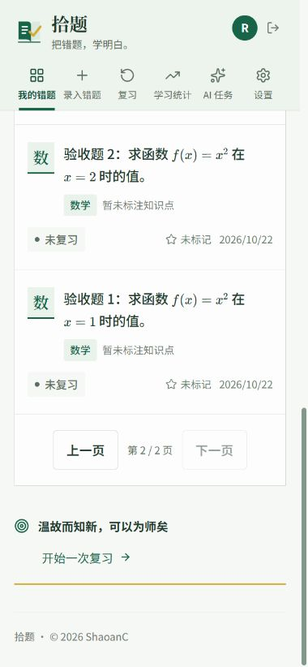

# 项目审查改进 · 2026-10-22

本轮审查提出的六项问题与四项后续方向均已实现，任务状态如下。所有步骤已完成代码编写和对应验证，没有 pending 或 in_progress 步骤。

| 步骤 | 状态 | 实现与验收 |
|---|---|---|
| 保存可靠性与编辑草稿 | completed | 保存期间新输入留在编辑页；新建 clientId 去重；字段原值校验及 409 冲突处理；按账号和题目恢复本机文字草稿；未提交图片离页提醒。核心及编辑烟测、手机恢复与保存流程通过 |
| 整页上传与删除重录 | completed | 离页、注销取消上传；压缩后及发送前检查取消状态；失败页保留原请求身份、新增页使用新批次；永久删除释放原题框；启动时修复旧版孤儿关联。整页及前端烟测、独立升级样本通过 |
| 复习筛选响应顺序 | completed | AbortController 与请求版本共同保护候选、错误和 loading。前端烟测覆盖旧成功、旧失败及卸载场景 |
| 列表分页与统计聚合 | completed | 列表每页 24 道摘要，公式保持完整；选择限于本页；导出按完整筛选读取正文。SQLite 聚合统计。核心分页、搜索、统计检查与浏览器 30 道完整导出通过 |
| 页面按需加载 | completed | 各业务页面及 AI 任务面板动态加载；加载失败保留刷新入口。生产构建通过，入口 JS 约 241 KB（gzip 约 76 KB），原构建约 1.54 MB（gzip 约 481 KB） |
| AI 重试释放执行槽 | completed | AI 识别及页面分题按单次请求占槽，退避与 Retry-After 由队列外定时调度；保留取消、停止、重启恢复。AI/整页烟测通过，包含退避期间新任务仍可完成 |
| 集成与文档 | completed | README、仓库指令与测试入口更新；最终构建、桌面布局边界及手机布局检查通过；临时服务和独立数据库已清理 |

## 验证

- `npm run build`：类型检查和生产构建通过。
- `npm test`：核心、搜索与认证通过；新增创建去重、同字段冲突、不同字段合并、分页摘要与聚合统计回归。
- `npm run test:ai`：使用本地模拟 AI 验证识别、重试、取消、停止与恢复。
- `npm run test:pages`：使用本地模拟服务验证整页分题、永久删除后原框重录、共享图清理和退避释放槽位。
- `npm run test:client`：编辑保存、草稿恢复、冲突解决、整页上传取消及复习请求竞态通过。
- 独立 SQLite 升级样本：旧版 `mistake_id IS NULL` 关联被清理，原框解除选择并移除旧关联状态。
- 浏览器：使用虚构账号和独立数据库，确认分页第二页、全量 30 道带答案解析导出、本机草稿离页恢复和保存到详情页；390px 手机及 1280px 桌面布局边界无横向溢出。最终构建未产生新的控制台错误。

所有 AI 检查使用模拟服务，没有调用真实或收费模型。

## 兼容与运行行为

`GET /mistakes` 不带 `page` 时继续返回完整数组，供复习、导出与既有调用使用。带 `page` 时返回 `{ items, total, page, pageSize }`，`summary=true` 省略答案、解析和笔记正文。搜索继续按相关性排序后分页。

未保存文字只存于当前浏览器，并按账号隔离；恢复编辑不会自动覆盖其他页面的新内容。未上传图片仍需重新选择，离页时会提醒。整页上传离页即取消，已被服务器接收的页面继续在后台分题，返回时可查看。

发布时照常保留数据库、图片目录和 `.env.ai`。首次启动自动新增创建去重表并清理历史孤儿题框关联。

## 手机布局截图

